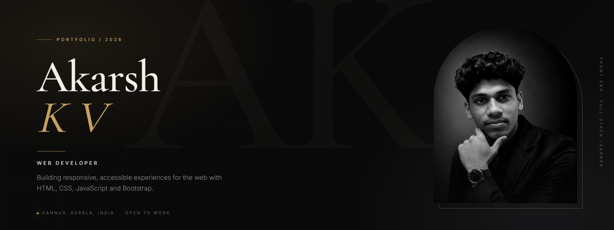
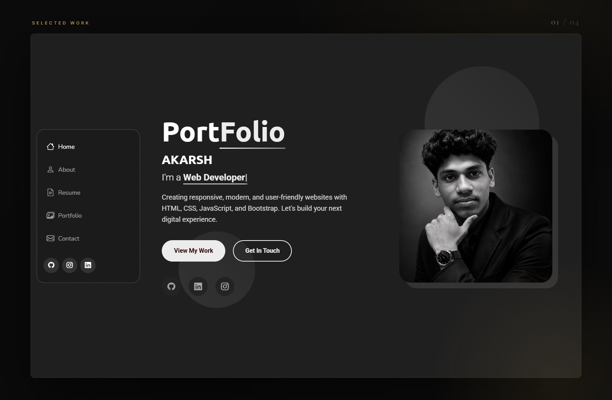
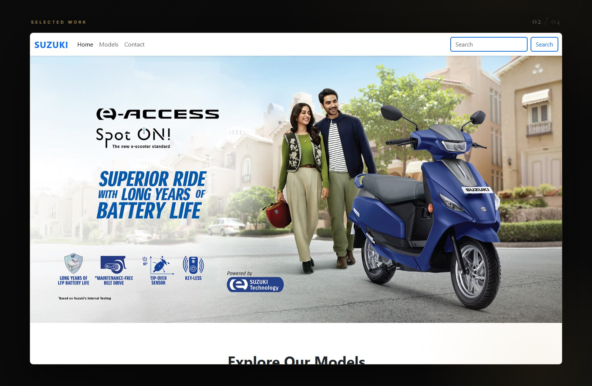
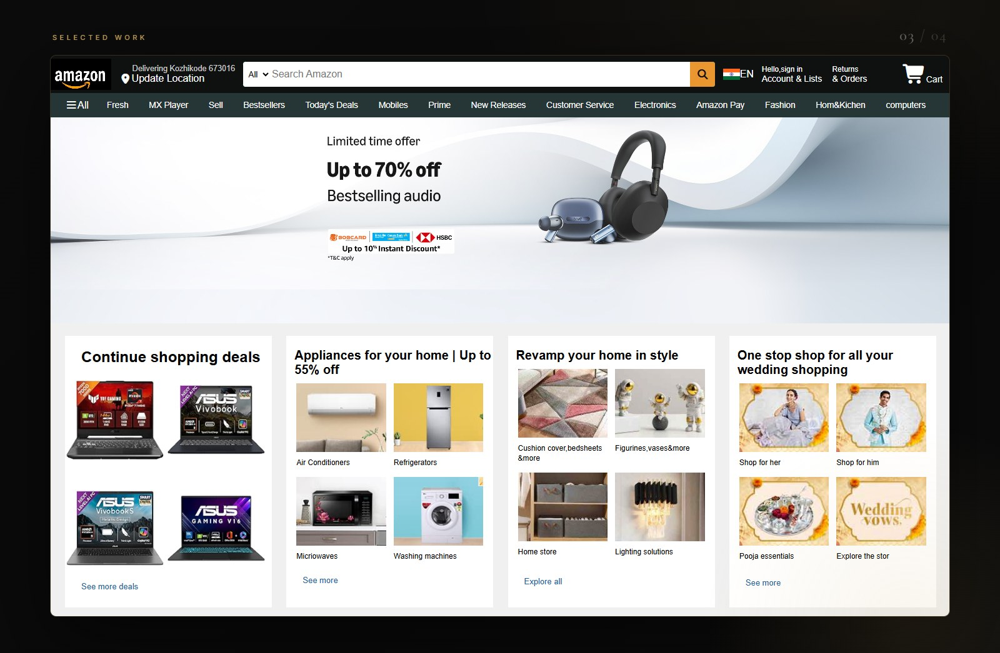
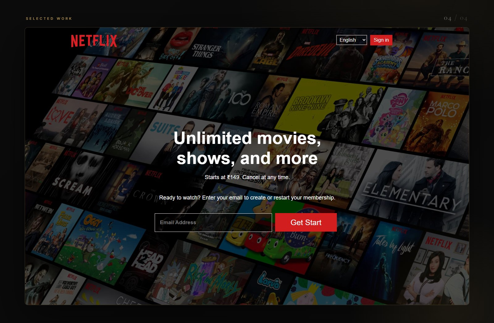

 

I'm a web developer from Kannur, Kerala, India. I build responsive, accessible
websites with HTML, CSS, JavaScript and Bootstrap, and I'm currently learning
full-stack development with Python, Flask and Django.

[Portfolio](https://akarshkv1234-glitch.github.io/portfolio/) · [LinkedIn](https://www.linkedin.com/in/akarsh-kv) · [Email](mailto:akarshkv1234@gmail.com)

---

## Selected Work

A few projects where I focused on layout, responsiveness and clean front-end
implementation.

### 01 — Personal Portfolio

A personal site with about, skills, resume, selected work and contact.
`HTML` `CSS` `JavaScript` `Bootstrap` · [Live site →](https://akarshkv1234-glitch.github.io/portfolio/)

 

### 02 — Suzuki Motorcycles

Responsive landing page for Suzuki Motorcycles India with a hero carousel and
model showcase.
`HTML` `CSS` `JavaScript` `Bootstrap` · [Live site →](https://akarshkv1234-glitch.github.io/SuzukiMotors/)

 

### 03 — Amazon Clone

A front-end recreation of the Amazon homepage, from the navigation and search
bar to the product sections.
`HTML` `CSS` · [Live site →](https://akarshkv1234-glitch.github.io/amazon-clone/)

 

### 04 — Netflix Clone

A responsive recreation of the Netflix landing page with a hero sign-up section
and feature layout.
`HTML` `CSS` · [Live site →](https://akarshkv1234-glitch.github.io/netflix-clone/)

---

## Capabilities

**Frontend** — HTML5, CSS3, JavaScript, Bootstrap  
**Backend** — Python, Flask, Django, SQLite  
**Tools** — Git, GitHub, Linux, Docker

---

## Currently

Learning full-stack development with Python, Flask and Django. Building a
WhatsApp reminder and expense-tracking bot, and a gold (XAU/USD) technical
analysis dashboard.

---

## Let's Talk

I'm open to internships, junior front-end roles and freelance work.

**[akarshkv1234@gmail.com](mailto:akarshkv1234@gmail.com)** · [LinkedIn](https://www.linkedin.com/in/akarsh-kv) · [Portfolio](https://akarshkv1234-glitch.github.io/portfolio/)

Kannur, Kerala, India

