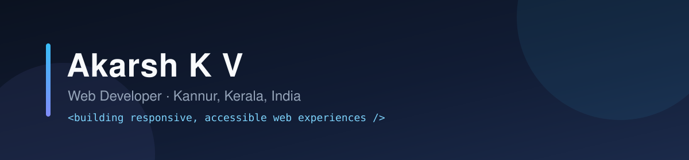

## About Me

I'm a web developer from Kannur, Kerala, India. I turn designs into fast,
responsive and accessible websites, mostly with HTML, CSS, JavaScript and
Bootstrap. I'm currently learning full-stack development with Python, Flask and
Django, and building small automation tools along the way.

- Focused on responsive, mobile-first front-end development
- Learning Python, Flask and Django
- Exploring developer tooling and practical automation
- Open to internships, junior developer roles and freelance work

## Tech Stack

**Frontend**

**Backend and Data**

**Tools**

## Featured Work

<table>
  <tr>
    <td width="50%" valign="top">
      
      <h3 align="center"><a href="https://github.com/akarshkv1234-glitch/portfolio">Personal Portfolio</a></h3>
      
My personal corner of the web: about, skills, resume, selected work and contact.

      

        
        
        
        
        
      

    </td>
    <td width="50%" valign="top">
      
      <h3 align="center"><a href="https://github.com/akarshkv1234-glitch/SuzukiMotors">Suzuki Motorcycles</a></h3>
      
Responsive Suzuki Motorcycles India landing page with a hero carousel and model showcase.

      

        
        
        
        
        
      

    </td>
  </tr>
  <tr>
    <td width="50%" valign="top">
      
      <h3 align="center"><a href="https://github.com/akarshkv1234-glitch/amazon-clone">Amazon Clone</a></h3>
      
A front-end recreation of the Amazon homepage with a responsive layout.

      

        
        
        
      

    </td>
    <td width="50%" valign="top">
      
      <h3 align="center"><a href="https://github.com/akarshkv1234-glitch/netflix-clone">Netflix Clone</a></h3>
      
A responsive recreation of the Netflix landing page.

      

        
        
        
      

    </td>
  </tr>
</table>

## Currently Building

- A WhatsApp reminder and expense-tracking bot running in Docker with SQLite
- A gold (XAU/USD) technical-analysis dashboard built with Flask and live market data

Both are private while I clean them up for release.

## GitHub Activity

## Get In Touch

I'm open to internships, junior web developer roles and freelance front-end work.
The fastest way to reach me is by email.

